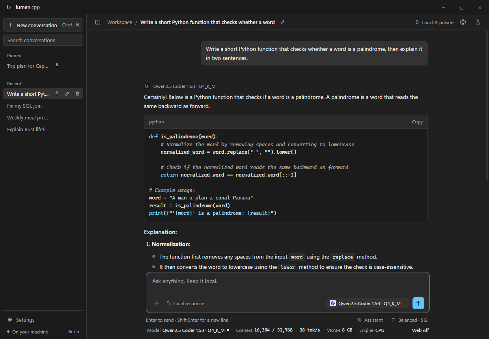
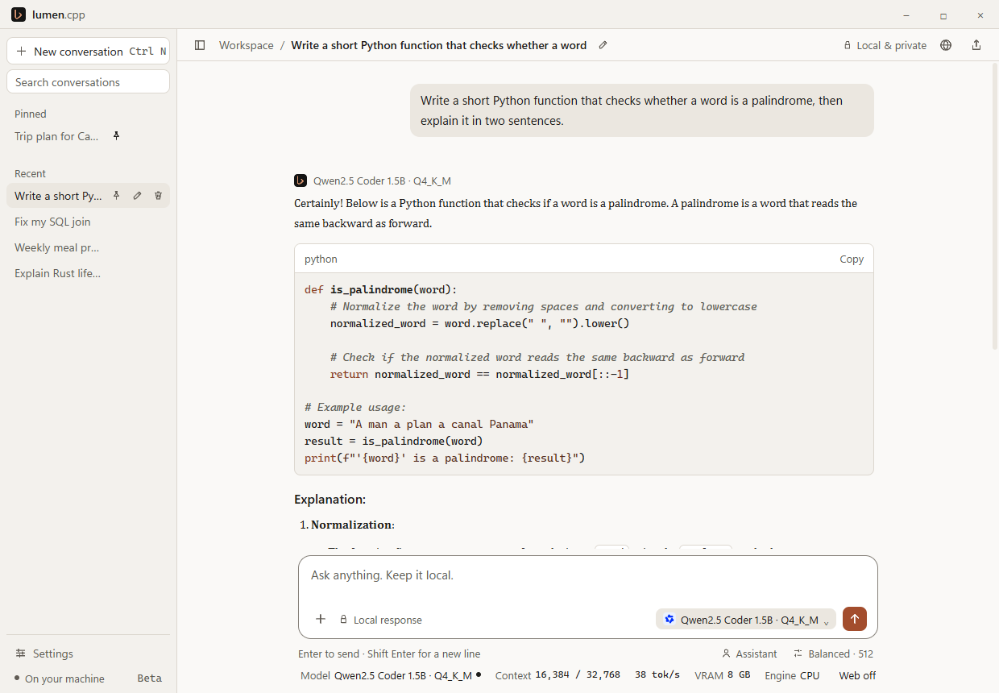
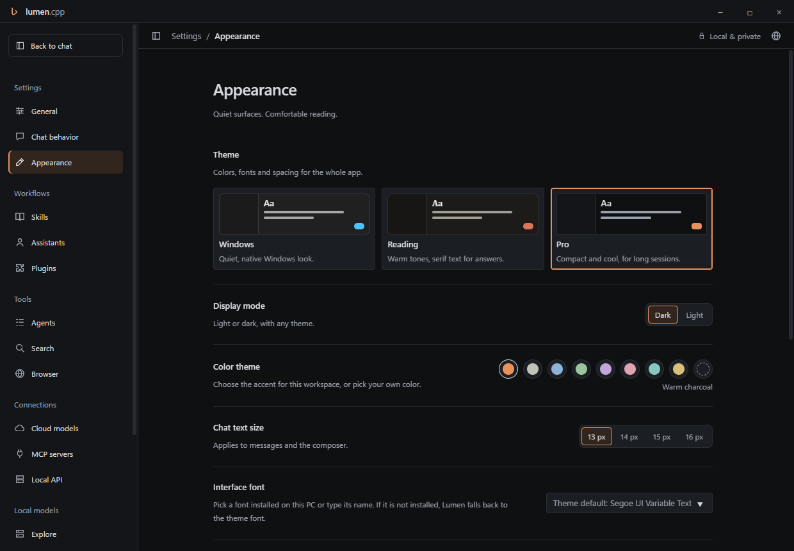

<div align="center">


# lumen.cpp

**Run open AI models on your own Windows PC. Private by default, no setup, no account.**

[](https://github.com/olves/lumen.cpp/releases)
[](https://github.com/olves/lumen.cpp/releases)
[](LICENSE)

[](https://github.com/ggml-org/llama.cpp)


[Download](#-download) · [Features](#-features) · [Engines](#-engines) · [Local API](#-use-it-as-an-api) · [Privacy](#-privacy) · [Build](#-build-from-source) · [Türkçe](#-türkçe)



</div>

---

### ⬇️ Download

<a href="https://github.com/olves/lumen.cpp/releases"></a>
<a href="https://github.com/olves/lumen.cpp/releases"></a>

From the [Releases](https://github.com/olves/lumen.cpp/releases) page, pick one:

- **`lumen-beta-setup.exe`** — installs for your user, no administrator rights. Start menu entry and uninstaller included.
- **`lumen-beta-portable.zip`** — extract anywhere and run `lumen.cpp.exe`.

There is nothing else to install: no Python, no Ollama, no npm. Choose a model in the app and start talking.

> [!NOTE]
> Lumen is a **Beta** and is not code-signed yet, so Windows SmartScreen may warn on first launch (**More info → Run anyway**).

---

### ✨ Features

**💬 Chat**
- Streaming answers with stop, **regenerate with up to 12 versions**, edit & branch, and **pinned conversations**
- Markdown with highlighted code, tables and math (KaTeX); HTML/SVG from replies opens in an **offline preview window**
- **Local search** across all conversations (Ctrl+K)
- **Drop or paste text and code files** into the message; add **PDF, Word and text documents** and get answers that cite the page ([D1], [D2]…)
- **Photos**: Windows OCR, plus real image input for vision models
- **Per-conversation run settings**: temperature, Top-P/K, Min-P, penalties, seed, response length, thinking, instructions with `{{current_date}}`
- **Thinking models** (Qwen3, Gemma 4…): reasoning in a collapsible block; Lumen detects which models support it

**🧠 Models**
- Browse **Hugging Face GGUF** repositories with a **"fits your PC" estimate** (GPU, GPU + RAM, or too large) and capability badges (thinking, vision, tools) before you download
- **Fast, verified downloads**: multiple connections, resume, SHA-256 check
- **Reuse models you already have** from LM Studio, Ollama, the Hugging Face cache, GPT4All or Jan, with no extra disk space on the same drive
- **Speed lab**: measure tokens per second and time to first token on your machine

**⚡ Performance**
- Automatic **GPU / RAM placement**, so large MoE models run on 8 GB GPUs
- **Auto context size** per model, compact 8-bit context cache, contexts up to 32K
- **Faster generation** with speculative decoding (n-gram and MTP draft models)
- **Live tokens/s** in the status line, and **free memory when idle** (unload the model after 5–60 minutes)

**🧩 Tools & extensions** *(all optional, off by default)*
- **Web research**: a planner and sub-agents search and read pages, then answer with sources. DuckDuckGo (no key), Brave, Tavily, Wikipedia or your own SearXNG
- **Built-in browser panel** with chat commands such as "open github.com" or "search lofi on youtube"
- **Coding agent on a project folder**: the model searches and reads only the lines it needs; with **Allow edits** on it changes and creates files, each change shown as a diff and applied only after you approve it, and the latest task can be undone. Works with local models and cloud models such as DeepSeek, with cache-friendly requests (80–90 % of input served from DeepSeek's cache after the first step), automatic context compaction, a live status (steps, tokens, cache rate, context) and per-task limits. It never runs commands or deletes files
- **MCP tools** over HTTP; every call shows its arguments and waits for your approval
- **Skills, assistants and plugins**: reusable instructions, saved personas with their own settings, and one-click bundles
- **Local image generation** with stable-diffusion.cpp (Z-Image Turbo)

**☁️ Cloud models** *(optional, bring your own key)*
- OpenAI, Anthropic, Gemini, DeepSeek, OpenRouter, Groq, Mistral or any OpenAI-compatible address
- Only the conversations where you pick a cloud model are sent, and only to that provider. The composer tells you so. Project folders work with cloud models after a one-time consent per provider; web research and connected tools stay local.

**🎨 Make it yours**
- Three themes (**Windows, Reading, Pro**), dark and light, preset or custom accent colors, fonts, text size and corner radius
- Status line under the composer or as a full status bar
- **English and Turkish** interface

<table>
<tr>
<td></td>
<td></td>
</tr>
<tr>
<td align="center"><sub>Reading theme, light</sub></td>
<td align="center"><sub>Settings → Appearance, Pro theme</sub></td>
</tr>
</table>

---

### ⚙️ Engines

Lumen bundles official, pinned builds and picks the best one for your hardware. Every engine download is checked against a fixed size and SHA-256 before use.

| Engine | What it runs | Backends |
|---|---|---|
| [llama.cpp](https://github.com/ggml-org/llama.cpp) | Chat, thinking and vision models (GGUF) | CUDA 13 · CUDA 12 · Vulkan (AMD, Intel, NVIDIA) · CPU |
| [stable-diffusion.cpp](https://github.com/leejet/stable-diffusion.cpp) | Local image generation | Vulkan · CUDA 12 · CPU |
| Windows OCR | Text in photos and screenshots | Built into Windows |

- **CPU and Vulkan are included**; CUDA is an optional download, with no toolkit or driver install.
- **Engine updates** are checked together with Lumen's own update; newer official builds are verified and tested before use and can be rolled back. The bundled engine always stays as a fallback.

---

### 🔌 Use it as an API

Turn on **Settings → Connections → Local API** and other programs on your PC can use your local models through an OpenAI-compatible endpoint:

```bash
curl http://127.0.0.1:11500/v1/chat/completions \
  -H "Authorization: Bearer lumen-YOUR-KEY" \
  -H "Content-Type: application/json" \
  -d '{"model": "Qwen2.5 1.5B", "messages": [{"role": "user", "content": "Hello!"}], "stream": true}'
```

```python
from openai import OpenAI

client = OpenAI(base_url="http://127.0.0.1:11500/v1", api_key="lumen-YOUR-KEY")
reply = client.chat.completions.create(model="Qwen2.5 1.5B", messages=[{"role": "user", "content": "Hello!"}])
print(reply.choices[0].message.content)
```

The server listens on **127.0.0.1 only**, needs the key shown in Settings, and lists only models installed on this PC (`GET /v1/models`).

---

### 🔒 Privacy

- **Everything stays on your PC** unless you pick a cloud model for a conversation. Chats, models and settings live in `%LOCALAPPDATA%\lumen.cpp`.
- The only automatic network request is a **once-a-day update check** (it can be turned off). Downloads happen only when you ask.
- The model server listens on loopback with a random key per launch. API keys and tokens are encrypted with Windows DPAPI.
- Web pages are treated as untrusted data; private and local network addresses are blocked. Model output is never run as HTML.
- **Signed updates**: each release carries an Ed25519-signed manifest, and an update installs only if the signature and the file's size and SHA-256 match.

---

### 🛠️ Build from source

Requirements: Windows 10/11 x64 and PowerShell. The script downloads its own pinned Electron and llama.cpp builds.

```powershell
.\scripts\build-portable.ps1
```

It downloads Electron and the official llama.cpp CPU and Vulkan builds (each checked against a pinned SHA-256), copies `app/` into place and compiles `lumen-host.exe`, `lumen-image-ocr.exe` and `lumen-updater.exe` with the .NET Framework compiler included in Windows.

<details>
<summary><b>Repository layout, tests and releases</b></summary>

```text
app/            Electron app: core (*.cjs), interface (*.js, *.css, index.html), vendored libraries
app/backend/    LumenCore.cs + LumenHost.cs (local engine host), LumenUpdater.cs, ImageOcr.cs
docs/           User guide, measurements, design notes
scripts/        build-portable.ps1, build-tauri.ps1, release.ps1 and pinned download manifests
shell-tauri/    Tauri 2 shell (Rust): development preview, not shipped
tests/          CDP harness, core tests and UI scenario tests for both shells
```

The interface is plain HTML, CSS and JavaScript with no build step. Tests need Node 22 and no npm packages; test data goes to `..\work\`, and the real `%LOCALAPPDATA%\lumen.cpp` is only read.

```powershell
node --test "tests/core/*.test.mjs"
$env:LUMEN_SHELL='electron'; node --test --test-concurrency=1 "tests/ui/*.test.mjs"
$env:LUMEN_SHELL='tauri';    node --test --test-concurrency=1 "tests/ui/*.test.mjs"
```

**Tauri preview.** The same `app/` also runs in a Tauri 2 shell (`.\scripts\build-tauri.ps1`, needs Rust with the MSVC target). It is a development build only; Electron is the shipped shell. Measurements: [docs/MEASUREMENTS.md](docs/MEASUREMENTS.md).

**Releases (maintainers).** Set the version and `build` in `app/package.json`, build the portable folder, then run `.\scripts\release.ps1 -AppDir <folder> -OutDir <folder> -NotesEn "..." -NotesTr "..."`. It produces the ZIP, the Inno Setup installer and the signed `lumen-update.json` + `.sig`. The signing key stays outside the repository.

</details>

---

### 💻 System requirements

- **Windows 10 or 11, 64-bit**, with .NET Framework 4.8 (built into current Windows)
- **8 GB RAM** or more is recommended; small models run on less
- **GPU optional**: NVIDIA (CUDA or Vulkan), AMD and Intel (Vulkan). Without one, models run on the CPU.

---

### 🩺 Troubleshooting

1. **SmartScreen warning** — Lumen is not code-signed yet: choose **More info → Run anyway**.
2. **A model does not fit** — pick a smaller quantization (Q4_K_M), lower the context size in Settings → Chat behavior, or set GPU memory to Auto.
3. **Something else** — the engine log is in `%LOCALAPPDATA%\lumen.cpp\desktop-engine.log`; please attach it to an [issue](https://github.com/olves/lumen.cpp/issues). More help: [docs/USER-GUIDE.md](docs/USER-GUIDE.md).

---

### 📄 License

[Apache License 2.0](LICENSE) — see also [NOTICE](NOTICE). Releases up to and including v1.0.3-beta were published under the MIT License. Third-party components are listed in [THIRD_PARTY_NOTICES.md](THIRD_PARTY_NOTICES.md). Downloaded models keep their own licenses.

### 🙏 Acknowledgements

[llama.cpp](https://github.com/ggml-org/llama.cpp) · [stable-diffusion.cpp](https://github.com/leejet/stable-diffusion.cpp) · [Electron](https://www.electronjs.org/) · [markdown-it](https://github.com/markdown-it/markdown-it) · [highlight.js](https://highlightjs.org/) · [KaTeX](https://katex.org/) · [PDF.js](https://mozilla.github.io/pdf.js/) · and every author who publishes open GGUF models on [Hugging Face](https://huggingface.co/).

---

### 🇹🇷 Türkçe

**Lumen**, açık yapay zekâ modellerini kendi Windows bilgisayarında çalıştırmanı sağlayan, kurulum ve hesap gerektirmeyen bir uygulamadır. Sohbetlerin, modellerin ve ayarların bilgisayarında kalır.

- [Releases](https://github.com/olves/lumen.cpp/releases) sayfasından **`lumen-beta-setup.exe`** (kurulum) veya **`lumen-beta-portable.zip`** (taşınabilir) dosyasını indir.
- Uygulamada bir model seç ve konuşmaya başla. Arayüz dili: **Ayarlar → Genel → Dil**.
- GPU şart değil; NVIDIA, AMD ve Intel ekran kartları desteklenir.
- Web araması, bulut modelleri, araçlar ve yerel API isteğe bağlıdır ve varsayılan olarak kapalıdır.

<div align="center">
<br>
<sub>Made for people who want their AI on their own machine.</sub>
</div>
