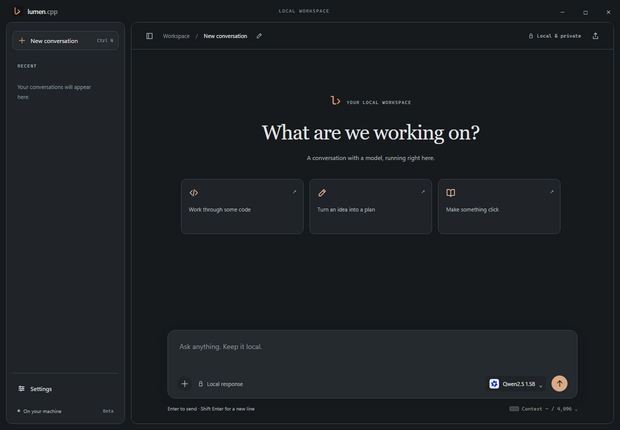

# lumen.cpp (Beta)

A local AI chat workspace for Windows. Lumen runs open models (GGUF) on your own computer with [llama.cpp](https://github.com/ggml-org/llama.cpp). There is nothing to install besides the app folder: no Python, no Ollama, no npm. Chats, models and settings stay on your machine.



> **Beta.** Lumen is a portable, unsigned Beta. Windows SmartScreen may warn on first launch.

## Features

- **Chat** with streaming answers, stop, branches, regenerate with versions, local chat search (Ctrl+K), Markdown with highlighted code, tables and math.
- **Models**: browse Hugging Face GGUF repositories, download with resume and SHA-256 checks, and see an estimate of whether a model fits your GPU, RAM or both.
- **GPU setup**: picks CUDA 13 / CUDA 12 / Vulkan / CPU automatically. AMD and Intel GPUs use Vulkan.
- **llama.cpp engine updates**: checked at startup with Lumen's own update; newer official builds are verified, tested and can be rolled back. The bundled engine stays as a fallback.
- **Performance**: automatic GPU/RAM placement (large MoE models work on 8 GB GPUs), compact 8-bit context cache, speculative decoding (n-gram and MTP draft models), contexts up to 32K, and an Auto context size per model.
- **Thinking models** (Qwen3, Gemma 4…): optional reasoning shown in a collapsible block. Lumen detects which models support it.
- **Photos**: OCR on Windows, and real image input for vision models with a projector (mmproj).
- **Web research (optional, off by default)**: a planner and sequential subagents search and read pages, then answer with citations. Providers: DuckDuckGo (whole web, no key), Tavily, Brave Search, Wikipedia, or your own SearXNG.
- **Browser commands in chat**: "open github.com", "search lofi on youtube", "click sign in", "scroll down", or chained ("open discord and press sign in"). Carried out directly in the built-in browser panel. Lumen never types into pages, and asks before buttons that pay, send or delete.
- **Project folder (read-only)**: let a model list, find, search and read files in a folder, with file citations. It cannot write, delete or run anything.
- **Skills**: reusable instructions and reference notes you select per conversation.
- **Desk / Studio layouts, light and dark, eight accent colors or your own, English and Turkish.**

## Download and run

From the [Releases](../../releases) page, pick one:

- **`lumen-beta-setup.exe`** installs Lumen for your user, with no administrator rights. It adds a Start menu entry and an uninstaller.
- **`lumen-beta-portable.zip`** can be extracted anywhere. Run `lumen.cpp.exe`.

Requirements: Windows 10/11 x64, .NET Framework 4.8 (built into current Windows). A GPU is optional.

Your data lives in `%LOCALAPPDATA%\lumen.cpp` (chats, models, settings). Updating never touches it. Uninstalling asks before deleting it.

### Updates

Lumen checks this repository's releases at most once a day; the check can be turned off in Settings → General. When a newer version exists, Lumen offers it and downloads only when you click.

Each release includes `lumen-update.json`, signed with an Ed25519 release key, plus its `.sig`. Lumen installs an update only if:
- the signature matches the public key built into the app;
- the downloaded file's size and SHA-256 match the manifest.

A small updater (`app/backend/LumenUpdater.cs`) then:
- runs the new setup silently for installed copies;
- swaps the folder for portable copies, restoring the old one if anything fails.

## Privacy and safety

- The model server listens on loopback only and uses a random key per launch.
- Your chats never leave your computer. The only automatic network request is the once-a-day update check (it reads the public release list and can be turned off); downloads happen when you ask. With web research on, search queries go to the provider you chose, and pages are fetched from their own sites. API keys are encrypted with Windows DPAPI.
- Model output is never executed as HTML. Web pages are read as untrusted data, with private and local network addresses blocked.
- Project folders are read-only. Keys, `.env` files and similar stay unreadable unless you allow a specific file.

More detail: [docs/USER-GUIDE.md](docs/USER-GUIDE.md). Measurements and test notes: [docs/MEASUREMENTS.md](docs/MEASUREMENTS.md).

## Repository layout

```text
app/                 Electron app: main process (*.cjs), renderer (*.js, *.css, index.html), vendored libraries
app/backend/         LumenHost.cs (engine host) and ImageOcr.cs (Windows OCR helper) sources
docs/                User guide, measurements, licenses
scripts/             build-portable.ps1 and the pinned Electron download manifest
```

The UI is plain HTML, CSS and JavaScript with no build step. Renderer scripts share one global scope and load in the order listed in `app/index.html`.

## Building from source

```powershell
.\scripts\build-portable.ps1 -Backend <path to lumen-core-beta.exe>
```

The script downloads Electron 44.5.1 and checks it against a pinned SHA-256. It then copies `app/` into place and compiles `lumen-host.exe` and `lumen-image-ocr.exe` with the .NET Framework compiler included in Windows.

Making a release (maintainers): set `app/package.json` to the new version (`1.0.3-beta`) and raise its `build` number by one, build the portable folder, then run:

```powershell
.\scripts\release.ps1 -AppDir <portable folder> -OutDir <folder> -NotesEn "..." -NotesTr "..."
```

It produces the portable ZIP, the Inno Setup installer (`scripts/lumen.iss`), and the signed `lumen-update.json` with its `.sig`. Upload all four files to a new pre-release. The signing key stays outside the repository (`%USERPROFILE%\.lumen-release`).

The native backend `lumen-core-beta.exe` comes from an earlier stage of the project, and its source is not available. Take it from the release ZIP (`resources/app/backend/`). `LumenHost.cs` uses it as a library and adds the newer engine features.

## License

MIT. See [LICENSE](LICENSE). Third-party components and their licenses are listed in [THIRD_PARTY_NOTICES.md](THIRD_PARTY_NOTICES.md). Downloaded models keep their own licenses.

---

**Türkçe:** Lumen, Windows'ta yerel yapay zekâ modelleriyle sohbet etmenizi sağlayan, kurulum gerektirmeyen bir uygulamadır (Beta). Releases sayfasından `lumen-beta-portable.zip` dosyasını indirin, bir klasöre çıkarın ve `lumen.cpp.exe`'yi çalıştırın. Arayüz Türkçe kullanılabilir (Ayarlar → Genel → Dil).
